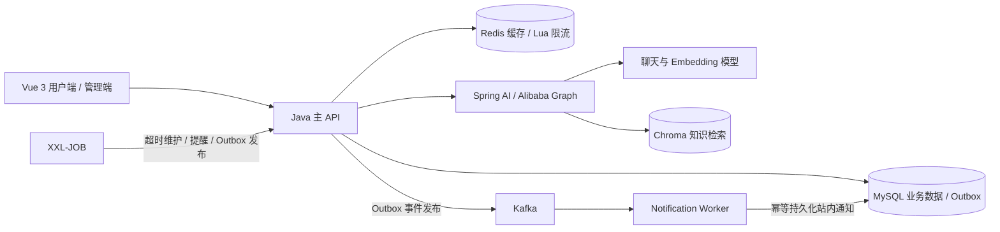

# CultureHub｜公共文化场馆活动预约与智能运营平台

CultureHub 面向博物馆、文化馆、社区文化中心等公共文化场所，提供从活动发布、场次预约、候补补位到签到核销、用户评价和运营复盘的完整业务流程。

项目基于 **Java 17、Spring Boot 3 和 Vue 3**，采用模块化单体主 API 与独立通知 Worker。Java 负责业务规则与数据一致性，Spring AI 提供导览推荐、活动策划和评价分析能力。

## 目录

- [项目功能](#项目功能)
- [技术栈](#技术栈)
- [系统架构](#系统架构)
- [核心设计](#核心设计)
- [项目结构](#项目结构)
- [快速开始](#快速开始)
- [测试与验证](#测试与验证)
- [文档导航](#文档导航)

## 项目功能

### 用户端与管理端

| 模块 | 主要功能 |
|---|---|
| 场馆、活动与权限 | 注册登录、JWT 认证、角色与场馆授权、活动草稿与发布、场次管理、分类筛选与分页 |
| 预约与候补 | 单场次预约、重复请求幂等、取消释放、持久化候补排队、补位确认与超时释放 |
| 站内通知 | 预约成功、取消、候补补位及活动提醒，支持通知列表和已读状态 |
| 电子签到 | 随机签到凭证、二维码展示、管理员核销、场次与时间校验、重复核销保护 |
| 评价与运营 | 已签到用户评价、评价修改、预约与候补统计、实时签到进度、最终签到率 |

普通用户管理自己的参与记录；场馆管理员管理授权场馆的活动、签到和报表；平台管理员管理场馆及授权。数据范围由后端校验。

### AI 功能

| 功能 | 实现方式 |
|---|---|
| 智能导览与活动推荐 | Alibaba Graph 编排多轮对话，结合 ChatMemory、Chroma RAG 和只读 Tool Calling 查询真实活动，使用 SSE 展示进度与回答 |
| 活动策划与文案生成 | ChatClient 结构化输出方案、流程和宣传文案，经 DTO 校验后预览、编辑并保存草稿 |
| 评价分析与运营复盘 | Java 查询统计与评价，AI 归纳反馈并生成结构化报告，保留来源与生成时间 |

活动时间和名额来自 MySQL。用户选择场次并独立确认后，AI 预约才会调用原有业务服务；聊天文本不代表预约成功。策划草稿需人工发布，复盘业务指标由 Java 计算。

## 技术栈

| 类别 | 技术 |
|---|---|
| 后端 | Java 17、Spring Boot 3、Spring Security、JWT |
| 数据访问 | MyBatis-Plus、JdbcTemplate、MySQL 8 |
| 缓存与并发 | Redis、Lua、MySQL 事务与行锁 |
| 消息与调度 | Kafka、Spring Kafka、Transactional Outbox、XXL-JOB |
| AI | Spring AI、Spring AI Alibaba Graph、Chroma |
| 前端 | Vue 3、Vite |
| 测试与部署 | JUnit 5、Testcontainers、Docker Compose |

## 系统架构



主 API 承担核心业务和三个 AI 功能，Worker 独立消费通知事件。MySQL 保存权威数据；Redis 提供展示缓存和入口控制，不维护第二套名额账本。

## 核心设计

- **预约一致性：** Redis Lua 入口限流，MySQL 场次行锁、条件更新及唯一约束防止超额和重复占位。候补顺序持久化，不依赖消息顺序。
- **可靠消息：** 业务变更与 Outbox 同事务提交，发布后由 Worker 幂等消费，配合重试、死信与重放处理失败。
- **签到与缓存：** 随机凭证配合事务及条件更新保证核销幂等；展示缓存短 TTL、提交后失效，多场次使用 MGET，缓存缺失时批量回源。
- **任务与统计：** 超时补位和活动提醒复用业务服务；报表批量分组聚合，区分当前人数、历史次数、实时进度和最终签到率。

一个账号对同一场次只能占用一个有效参与资格，预约与候补互斥。活动免费，不涉及支付，不支持代报名或一次预约多人。

## 项目结构

```text
CultureHub/
├── culturehub-contracts/             # 业务事件契约
├── culturehub-business/              # 业务服务、事务、缓存、消息、任务与 AI
├── culturehub-api/                   # HTTP 接口、认证配置、演示数据初始化
├── culturehub-notification-worker/   # Kafka 消费、通知持久化、死信处理
├── web/                             # Vue 3 用户端与管理端
├── deploy/                          # 数据库 DDL、初始化与迁移脚本
├── scripts/                         # 初始化、验证和源码打包工具
├── docs/                            # 设计、API、学习与验证说明
├── compose.yaml                     # 完整本地环境配置
└── .env.example                     # 环境变量模板
```

## 快速开始

### 本地开发

准备 JDK 17、Maven 3.6.3+、Node.js 22、MySQL 8 和 Redis。以下使用 PowerShell：

```powershell
git clone https://github.com/amiragez0215/CultureHub.git
cd CultureHub
Copy-Item .env.example .env
```

按本机环境修改 `.env` 中的数据库、Redis 和 JWT 配置。主 API 从项目根目录读取该文件，模型默认关闭，不影响普通业务启动。

启动 MySQL、Redis 后，初始化专用演示库并运行后端：

```powershell
$env:MYSQL_PWD='你的MySQL密码'
$env:DEMO_PASSWORD='123'
.\scripts\init-demo.ps1 -Database culturehub_demo -Port 3306
```

脚本会构建后端，在专用 `_demo` 库创建表结构、执行迁移并初始化演示数据。包含 8 个场馆、30 个活动和 50 个场次，覆盖可预约、满额、候补、签到及结束等场景；重复启动保留已有记录。

另开终端启动前端：

```powershell
cd web
npm ci
npm run dev
```

前端默认访问 `http://localhost:5173`，API 为 `http://localhost:8080/api/v1`；端口被占用时以前端终端输出为准。Vite 默认代理到 API 的 8080 端口。

| 演示角色 | 账号 | 密码 |
|---|---|---|
| 平台管理员 | `admin` | `DEMO_PASSWORD`，上述示例为 `123` |
| 场馆管理员 | `manager1` — `manager8` | 同上 |
| 普通用户 | `user`、`demo01` — `demo23` | 同上 |

基础演示模式关闭任务执行器。异步通知需要另行配置 Kafka 并启动 Worker；定时调度需要 XXL-JOB。详细步骤见[本地运行与演示说明](docs/learning-and-demo.md)。

### Docker Compose

仓库提供 MySQL、Redis、Kafka、XXL-JOB、Chroma、API、Worker 和前端的 Compose 配置。配置好 `.env` 后执行：

```sh
docker compose up --build -d
```

前端地址为 `http://localhost:8089`，API 为 `http://localhost:8080/api/v1`。完整容器部署尚未在当前开发环境验收，具体配置以 `compose.yaml` 为准。

### AI 配置

在 `.env` 配置 `AI_CHAT_PROVIDER`、`AI_API_KEY`、`AI_BASE_URL` 和 `AI_CHAT_MODEL`。启用 RAG 还需要独立配置 Embedding 模型、Chroma，并导入公开场馆知识。

未配置模型时，AI 接口返回明确的不可用提示；未配置知识库时，活动推荐仍可查询业务数据库。模型接入与知识导入见 [AI 配置说明](docs/ai-and-startup.md)。密钥只保存在本地配置中，不提交 Git。

## 测试与验证

```sh
mvn -s settings.xml test
cd web
npm ci
npm run test:ui
npm run build
```

普通单元测试不依赖 Docker，容器集成测试在 Docker 不可用时跳过。也支持专用本地 MySQL/Redis 集成测试，启用方式及清表范围见[技术增强说明](docs/technical-enhancement.md#复测与学习)。

已执行后端构建、单元测试、真实 MySQL/Redis 核心业务测试、前端交互与构建、DeepSeek 业务联调。完整 Kafka 故障恢复、XXL-JOB Admin 调度、Embedding/Chroma 检索质量和大规模压测尚未验收，详见[验证记录](docs/verification.md)及 [AI 连接容错回归](docs/ai-connection-fix.md)。

## 文档导航

| 文档 | 内容 |
|---|---|
| [本地运行与演示](docs/learning-and-demo.md) | 初始化、演示账号、学习顺序 |
| [API 文档](docs/api.md) | 业务接口、权限与错误码 |
| [架构与一致性设计](docs/design.md) | 模块职责、事务、状态机与消息机制 |
| [技术增强与源码导读](docs/technical-enhancement.md) | Redis 批量读取、SQL 优化、SSE、ORM 迁移 |
| [AI Graph 设计](docs/ai-graph-upgrade.md) | 多轮推荐、只读工具与独立预约确认 |
| [AI 配置与启动](docs/ai-and-startup.md) | 模型、Embedding 与知识库配置 |
| [实际验证记录](docs/verification.md) | 已执行测试及环境限制 |
