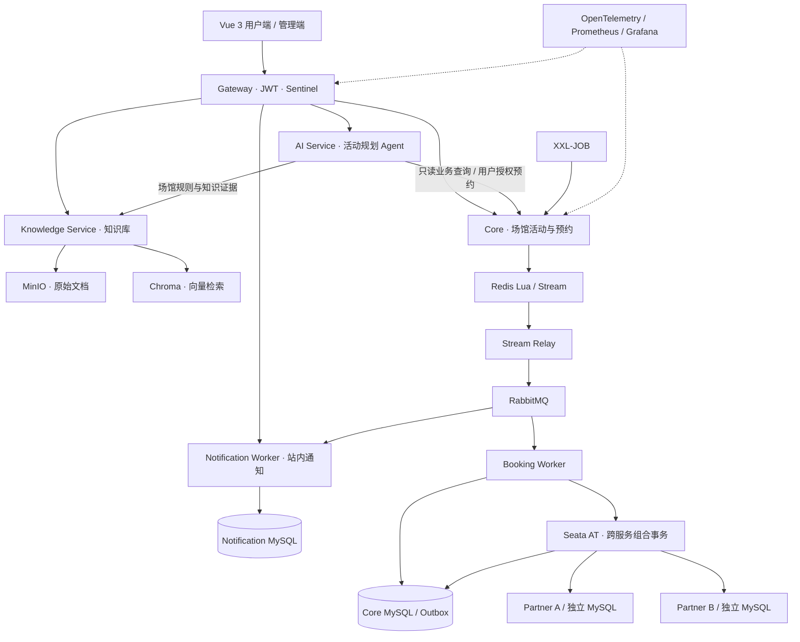

# CultureHub｜公共文化活动预约与智能规划平台

CultureHub 面向博物馆、文化馆和社区文化中心，提供活动发布、场次预约、FIFO 候补、电子签到、站内通知与运营统计，并通过 AI Agent 将自然语言需求转化为可执行的文化活动安排。

项目采用 **Java 17 + Spring Boot 3 + Vue 3**，围绕有限名额预约、可靠异步消息、跨服务事务和用户授权实现完整业务流程。

## 核心能力

| 业务场景 | 实现能力 |
| --- | --- |
| 场馆与活动 | 场馆分类、活动筛选与分页、详情展示、活动草稿、发布和取消、独立场次与容量管理 |
| 用户与权限 | 注册登录、Spring Security / JWT、平台管理员与场馆管理员、后端场馆数据授权 |
| 预约与候补 | 异步受理、请求状态查询、防超额、防重复、取消释放、持久化 FIFO、候补确认与超时补位 |
| 组合预约 | 同库多场次本地事务确认，Core + Partner A/B 跨服务 Seata AT，整组结果查询与故障恢复 |
| 签到与评价 | 安全随机凭证、二维码展示、场次和时间窗口校验、重复核销保护、已签到用户评价 |
| 通知与报表 | 预约和候补站内通知、已读状态、报名与取消统计、签到进度、最终签到率 |
| AI 活动规划 | 多轮需求修改、真实场次查询、同馆 1～3 个活动组合、规则来源、方案校验、明确授权预约 |
| 知识库 | 文档上传、异步解析与向量入库、场馆范围检索、版本切换 |

普通用户可浏览活动、预约候补、查看签到凭证与通知，并与文化助手规划行程。管理员可管理授权场馆的活动与场次、核销签到、查询参与记录和运营报表。

## 技术栈

| 类别 | 技术 |
| --- | --- |
| 开发语言与框架 | Java 17、Spring Boot 3.5.7、Spring Cloud、Spring Cloud Alibaba |
| 网关与服务治理 | Spring Cloud Gateway、Nacos、OpenFeign、Sentinel |
| 安全认证 | Spring Security、JWT、角色权限与场馆数据授权 |
| 数据访问 | MyBatis-Plus、MyBatis XML、JdbcTemplate、MySQL 8 |
| 缓存与预约入口 | Redis、Lua、Redis Stream、MGET / Pipeline |
| 可靠消息 | RabbitMQ、Spring AMQP、Transactional Outbox、Quorum Queue |
| 分布式事务 | Apache Seata AT 2.5.0 |
| AI 与知识检索 | Spring AI、Spring AI Alibaba Graph、ChatClient、Chroma、MinIO |
| 调度与可观测性 | XXL-JOB、Micrometer、OpenTelemetry、Prometheus、Grafana |
| 前端与工程 | Vue 3、Vite、Maven 多模块、Docker Compose |
| 测试 | JUnit 5、Testcontainers、真实 MySQL / Redis / RabbitMQ / Seata 联调 |

## 系统架构



Core、AI、Knowledge 和 Notification 使用独立数据库。Partner A/B 提供受控组合预约演示目录，用于验证独立服务之间的事务与恢复。服务间通过内部凭据校验调用身份，用户请求通过 JWT 与角色、场馆授权校验。

## 关键技术设计

### Redis Lua + Stream + RabbitMQ 异步预约

预约请求先在 MySQL 登记稳定的 `request_id`，随后通过 Redis Lua 原子完成预留、幂等判断和 Stream 写入。Relay 等待 RabbitMQ Confirm 并核对 Return 后确认 Stream 消息，Booking Worker 在本地事务中完成最终预约。

MySQL 场次行锁、容量条件更新和有效资格唯一约束共同保证名额正确。前端跟踪“已受理 → 处理中 → 最终结果”，重复提交使用原请求编号恢复结果。

### 持久化 FIFO 与候补确认

候补序号在 MySQL 场次锁内分配并持久化。取消释放的名额优先交给候补队首，获得机会后暂占名额，用户在有效期内明确确认。超时释放继续触发补位，较早登记的候补请求参与优先权判断。

### Seata AT 跨服务组合预约

同库组合由 Worker 在一个 MySQL 本地事务中确认多个场次。跨服务组合在 Worker 单次执行期间开启 AT 全局事务，同步调用 Core、Partner A 和 Partner B，并传播同一 XID。

各服务通过 DataSourceProxy 和独立 `undo_log` 参与事务。数据库结果与 Redis Hold 收尾分别持久化，收尾失败可幂等重试。用户明确授权部分保留后，系统在整组回滚和释放完成后逐项发起独立预约。

### Transactional Outbox 与可靠站内通知

业务数据与 Outbox 事件在同一本地事务中写入。发布器采用并发领取、失败退避与超时恢复，单条失败继续处理批内其他事件。Notification Worker 通过 `event_id` 幂等落库，配合消费 ACK、有限重试和死信队列完成恢复。

### AI 文化活动规划 Agent

Spring AI Alibaba StateGraph 实现 15 个职责明确的逻辑节点，以条件边连接需求理解、业务工具、独立 RAG、证据评价、组合优化、方案验证和有限修复。

- **需求理解**支持相对日期、硬约束、软偏好和多轮修改。
- **只读工具**查询真实场次、余量快照、场馆与当前用户已有预约。
- **RAG**按场馆和知识类型检索，保留文档来源、版本及证据引用。
- **确定性规划**计算活动顺序、衔接间隔、时间冲突和同馆组合。
- **独立验证**核对场次真实性、时间和约束，并按错误来源定向修复。
- **授权执行**先保存计划和待确认提案，用户明确确认后调用 Java 预约业务。
- **会话恢复**结合 Redis 会话与 Checkpoint、MySQL 计划版本和稳定预约提案。
- **SSE 交互**展示生成进度、活动卡片、组合安排、规则来源与预约处理结果。

### 查询、缓存与可观测性

常规业务查询使用 MyBatis-Plus，活动关联筛选、预约历史分页和运营统计采用 XML 动态 SQL、多表 JOIN 与数据库聚合。Redis 使用 Cache-Aside、批量读取和提交后失效，减少重复查询与网络往返。

Gateway、Stream、RabbitMQ 和 Worker 传递 Trace，上报 HTTP、JVM、连接池和业务积压指标。Grafana 提供统一观测面板。

## 项目结构

```text
CultureHub/
├── culturehub-contracts/             # 消息与服务契约、可靠发送、Trace 与指标
├── culturehub-business/              # 预约状态机、Worker、候补、签到与组合事务
├── culturehub-api/                   # Core API、权限、场馆活动与内部服务接口
├── culturehub-ai/                    # 独立 AI 服务、规划与授权接口
├── culturehub-knowledge/             # 知识上传、异步入库、检索与版本
├── culturehub-notification-worker/   # 通知消费、持久化与查询
├── culturehub-gateway/               # 路由、JWT 与 Sentinel
├── culturehub-service-runtime/       # 服务边界测试夹具
├── web/                             # Vue 3 用户端与管理员端
├── deploy/                          # 数据库脚本、镜像与监控配置
├── scripts/                         # 环境初始化、联调、故障与压测脚本
├── docs/                            # 架构、接口与测试文档
└── compose.v3.yaml                  # V3 完整部署配置
```

## 快速开始

准备 Docker Compose，并在项目根目录执行。

```sh
git clone -b codex/culturehub-v3 https://github.com/amiragez0215/CultureHub.git
cd CultureHub

python scripts/v3-p6/init-env.py --demo
docker compose --env-file .env.v3 -f compose.v3.yaml up --build -d
```

初始化脚本生成本地 `.env.v3`，包含数据库、JWT 和服务凭据。使用 `--demo` 创建演示账号，密码为 `123`。开启 Partner 演示目录可在首次初始化前设置 `V3_DEMO_ENABLED=true`。

| 入口 | 地址 |
| --- | --- |
| 用户端与管理员端 | http://localhost:8089 |
| Gateway API | http://localhost:8090/api/v1 |
| Grafana | http://localhost:3000 |

前后端独立开发可分别执行 Maven 和 Vite 构建，详细配置见 [本地运行与启动说明](docs/v3-start.md)。

### AI 模型配置

在本地 `.env.v3` 中填写聊天模型配置。

```dotenv
AI_CHAT_PROVIDER=openai
AI_BASE_URL=https://api.deepseek.com
AI_CHAT_MODEL=deepseek-chat
AI_API_KEY=填写自己的_API_Key
```

Embedding 使用 `AI_EMBEDDING_PROVIDER`、`AI_EMBEDDING_BASE_URL`、`AI_EMBEDDING_MODEL` 和 `AI_EMBEDDING_API_KEY` 配置，向量存储设置为 `AI_VECTORSTORE=chroma`。知识库服务负责文档上传、异步入库和版本管理。

## 测试与工程实践

项目包含单元测试、接口测试、真实中间件联调及故障注入脚本。已执行的完整 Java 回归覆盖预约、FIFO、Outbox / RabbitMQ、权限、AI Graph 与 Gateway，其中 **310 项通过，失败和错误均为 0**。

真实 Seata 联调覆盖三库提交、后置参与方失败回滚、同 XID 与 undo 清理、Redis 收尾重试、重复命令以及 Worker / TC 重启恢复。前端覆盖 Vue 交互、SSE 数据解析与生产构建。

```sh
mvn -B -ntp -s settings.xml test
npm --prefix web ci
npm --prefix web run test:ui
npm --prefix web run build
```

HTTP 压测提供 50、100、200 并发的预约场景，校验有效资格、已占用名额和容量约束，保留原始响应、分类统计与数据库终态。结果见 [HTTP 压测记录](docs/v3-http-performance.md)。

## 源码与文档导航

| 内容 | 入口 |
| --- | --- |
| 系统架构与服务职责 | [V3 架构](docs/v3-architecture.md) |
| 启动、环境变量与数据库配置 | [启动说明](docs/v3-start.md) |
| 业务接口与整组授权 | [V3 API](docs/v3-api.md) |
| AT 事务调用链与恢复 | [Seata AT 实现](docs/v3-seata-at.md) |
| 预约登记、幂等与持久化 FIFO | [BookingLedger](culturehub-business/src/main/java/cn/culturehub/BookingLedger.java) |
| 异步 Relay、消费和恢复 | [BookingPipeline](culturehub-business/src/main/java/cn/culturehub/BookingPipeline.java) |
| 组合请求与收尾恢复 | [CombinationBooking](culturehub-business/src/main/java/cn/culturehub/CombinationBooking.java) |
| 跨服务全局事务 | [CombinationGlobalTransaction](culturehub-business/src/main/java/cn/culturehub/CombinationGlobalTransaction.java) |
| AI Graph 规划与验证 | [GuideGraphV2](culturehub-business/src/main/java/cn/culturehub/ai/guide/GuideGraphV2.java) |
| MyBatis-Plus 与 XML 查询 | [数据访问实践](docs/data-access-upgrade.md) |
