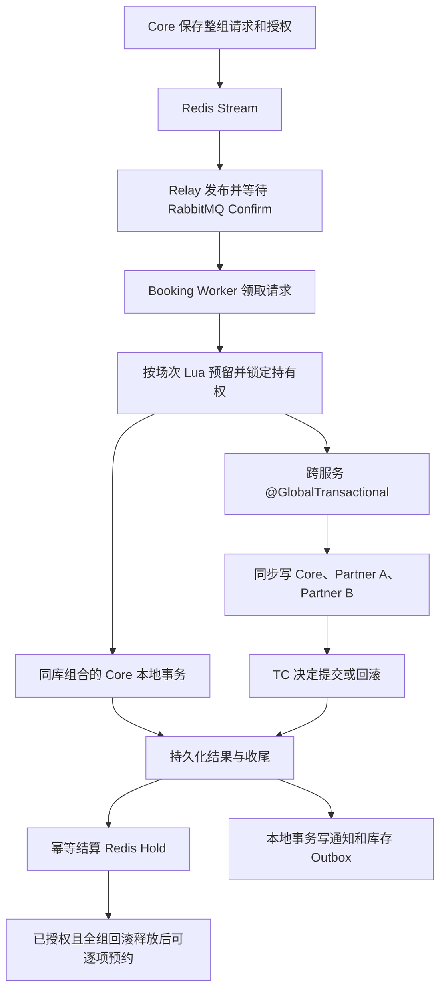

# CultureHub V3 跨服务组合预约与 Seata AT

Core 接管组合提交、历史和结果查询。Gateway 保留原 URL、JWT 与 Sentinel 组合预约限流，AI 保留持久化授权和稳定 request_id。Partner A/B 仅通过受控目录提供演示场次。



## 事务与恢复

- `combination_request` 在 Core 保存 request_id、授权、执行代次、XID、数据库结果和处理阶段。重复提交返回同一请求，RabbitMQ 重投不能重复领取已执行的代次。Stream 或消息丢失时，由持久化请求补投。
- `combination_branch` 与原有 `booking_request`、`reservation_hold` 约束场次 Hold。登记、Lua 预留、锁定和收尾分阶段执行。正在等待全局结果的场次通过持久化 Hold 阻止普通预约、候补和取消改写 AT 尚未定案的记录。等待超时由 TC 回滚，应用继续核对结果。
- 内部 Hold 与独立补选请求使用现有保留的 `v3-` 请求编号前缀，普通预约入口对新提交拒绝该前缀。
- Seata 2.5.0 为每个服务的数据源启用一次 AT 自动代理。Worker 跨服务确认使用一个 15 秒全局事务，每个 HTTP 分支有连接和读取超时。进入 Partner 的确认接口时验证内部凭据、绑定 XID，调用 Spring 本地事务后释放线程上下文。AT 内只执行参数化单表插入、按主键更新、锁定读和业务校验。三库的业务表均使用 InnoDB，且写入表均有主键。
- AT SQL 解析使用 Druid。Maven 统一 ANTLR runtime 4.13.1，以兼容 Spring AI 的过滤表达式。回归覆盖 Seata 依赖引入后的原 AI Graph 测试。
- 全局阶段前先持久化 XID。TC 仍在回滚、重试或暂时断开时，保持 `PROCESSING`。TC 返回 `Finished` 时，Seata 已移除会话，Core 逐库核对预约记录与有效 undo 日志，再判定提交或回滚。部分记录仍存在或结果无法核实时，保留持有权并进入 `MANUAL_INTERVENTION`。
- AT 分支只写资格、历史和容量。提交后使用各分支本地事务生成通知与库存 Outbox，随后幂等结算 Redis Hold。回滚后只结算释放。Redis 暂不可用时保持已确定的 `db_result`，并重试 `SETTLING`。持续无法收尾时转人工核对，保留数据库结果。授权的部分保留在整组回滚且释放后才执行，并复用普通异步预约、限流与稳定请求编号。

## 部署和切换

全新环境按 [V3 启动说明](v3-start.md) 启动。Compose 使用 `apache/seata-server:2.5.0`，TC 对应用网络提供 `seata:8091`，使用 File 注册配置和持久化事务卷。保留该卷才能跨进程重启恢复。Core、Partner A/B 使用相同的事务组 `culturehub_at`。应用使用 Java 17 和 Spring Boot 3.5.7。

已有 V3 环境先暂停旧组合入口，在旧版运行期间结清所有未完成组合、补偿、Hold 和待发布事件。保留旧库快照及旧组合记录作为历史，随后停止旧 Orchestrator 与参与方，避免两个版本同时运行。以数据库管理员对 `core_db`、`partner_db_a`、`partner_db_b` 依次执行 `20261114-v3-seata-at.sql`，再对 `core_db` 执行 `20261114-v3-combination.sql`。旧 Saga 表无需应用访问，历史请求不会自动导入新版组合查询。历史 SQL 和测试见 [归档](archive/v3-saga)。

已确认旧任务全部结清并备份后，可对三个业务库执行可选的 `20261114-v3-retire-saga.sql` 清理专用参与方表。保留既有预约资格、请求、库存审计和 Outbox。现有 `.env.v3` 可沿用旧内部凭据，新增环境使用 `V3_COMBINATION_TOKEN`。

## 修改位置

| 位置 | 改动 |
|---|---|
| `culturehub-business` | 新组合请求恢复、参与方 Hold、AT 事务入口。移除 Saga 数据库补偿和消息路由。 |
| `culturehub-api` | Core 组合 API、Partner 内部接口、Seata Client 和数据源代理配置。 |
| `culturehub-contracts` | 组合命令及分支契约。 |
| `culturehub-ai`、`culturehub-gateway`、`web` | 调用 Core，显示数据库结果与收尾进度，保留明确部分授权。 |
| `deploy/migrations`、`compose.v3*.yaml` | 三库 undo_log、持久化组合请求、TC 与持久化卷。 |
| `scripts/v3-p4/run-local.py` | 本机真实 MySQL、Redis、RabbitMQ、Seata TC 和三应用进程验收。 |

参考 [Apache Seata 2.5 AT 机制](https://seata.apache.org/docs/v2.5/dev/mode/at-mode/) 与 [2.5.0 TC 源码](https://github.com/apache/incubator-seata/blob/v2.5.0/server/src/main/java/org/apache/seata/server/coordinator/DefaultCore.java)。

## 复现命令

使用隔离 MySQL 13306、Redis 16379、RabbitMQ 5673 和 Seata 18091。Seata 使用官方 2.5.0 二进制，应用连接与 Compose 相同的 AT 客户端配置。故障测试自行启动第二个 TC，使用独立事务目录和 18092 端口。

```powershell
$env:RABBIT_PORT = '5673'
$env:RABBIT_VHOST = 'culturehub_v3p1_audit'
mvn -o -B -ntp -s settings.xml '-Dculturehub.localTest=true' '-Dculturehub.p2LocalTest=true' '-Dculturehub.rabbitLocalTest=true' '-Drabbit.port=5673' package
$env:V3_TEST_JAVA = 'D:/Test_Soft/jdk17/bin/java.exe'
$env:V3_TEST_MYSQL = 'D:/mysql/mysqlx/bin/mysql.exe'
$env:SEATA_TEST_HOME = '<解包后的 seata-server 目录>'
$env:SEATA_TEST_RESTART = 'true'
python scripts/v3-p4/run-local.py
python scripts/v3-p5/run-local.py
npm.cmd --prefix web run test:ui
npm.cmd --prefix web run build
```

## 验收记录

本机使用 Seata TC 2.5.0、MySQL 8.0.27、Redis 7.4.9、RabbitMQ 4.1.4 与三个独立 Java 服务进程。TC 发行包经 Apache SHA-512 校验。

| 场景 | 实际验证 |
|---|---|
| 同库组合 | 两个场次全部确认，XID 为空。无效场次使整组失败，数据库无新增有效资格。 |
| 跨库提交 | Core、A、B 共享 XID，三库均生成资格并清理 undo。 |
| 跨库回滚 | 在 Core、A 已有 undo 后令 B 写入失败，三库有效资格和占用均归零，Redis Hold 完成释放。 |
| Redis 收尾恢复 | 分别让提交和回滚后的 Lua 结算失败，数据库结果保持原值。修复 Redis 测试键后，从持久化状态完成收尾。 |
| 重复投递 | HTTP 使用原 request_id 返回同一请求，重复注入 Stream 命令并经 RabbitMQ 投递后没有执行第二次确认。 |
| Worker 与 TC 重启 | 已观察到 Partner A undo 时终止 Core Worker 和独立 TC。重新打开原 TC 事务目录、启动 Core 后，TC 回滚并释放全部 Hold。 |
| 授权部分保留 | 先释放整组 Hold，然后用稳定的独立请求预约仍可用场次，关闭的场次没有获得资格。 |
| AI 到 Core | 使用已验证计划夹具测试授权。显式确认后在 Core 本地事务完成两个场次，重复确认和授权历史返回同一个组合请求。单场预约也走真实 Redis、Stream、RabbitMQ 和 Worker。 |

Maven 全量回归记录为 409 个用例，310 通过，0 失败，0 错误，99 跳过。97 个需要 Docker，2 个需要本地 Chroma 配置。覆盖原有预约、FIFO、超时竞争、Outbox/RabbitMQ、权限、AI Graph 及 Gateway。旧 Saga 专用用例归档，AT 故障场景由新的实机脚本验证。Vue 交互回归和生产构建通过。当前机器未提供 Docker，Compose 已生成并静态检查，容器镜像启动和干净卷初始化待实机验证。人工介入状态已实现，永久性 undo 脏写导致的不可恢复回滚未注入。

上述端到端证据来自切换内部请求编号前缀前的构建。最后将 Hold 和独立补选编号放入已有的 `v3-` 保留前缀，并在脚本中补充了普通入口拒绝该前缀的断言。包含此改动的最终 Maven 打包已通过。执行最后一次实机回归的自动审批因用量限制未完成，因此该前缀改动的端到端复测待执行。
